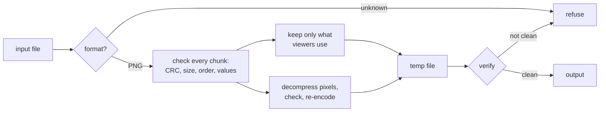

<div align="center">

# traceless

**See what your files reveal about you, then make them forget it.**

A fast metadata remover that rebuilds files from scratch,
so even data hidden where other tools don't look is gone.

</div>

---

A photo can carry your home's GPS coordinates. A screenshot can name your
phone. A PNG can carry anything after its last byte, and most viewers will
never show it. traceless finds all of it and removes it.

```console
$ traceless inspect photo.png
photo.png (PNG):
  ICC profile: Pixel 7 Pro camera (49 bytes)
  tEXt Author: Jane Doe
  ...
  EXIF Model: Pixel 7 Pro
  ...
  EXIF CameraOwnerName: Jane Doe
  EXIF BodySerialNumber: SN-1234567
  EXIF GPS position: 52.520000, 13.405000
  EXIF Thumbnail: 5120 bytes
  Modified: 2024-05-01 12:30:00 UTC
  prVt chunk: 16 bytes
  Trailing data: 14 bytes after IEND

$ traceless strip photo.png
photo.png -> photo.clean.png (PNG)

$ traceless verify photo.clean.png
photo.clean.png (PNG): clean
```

## What other tools miss

Metadata tools look for the fields they know. Data hidden anywhere else is
never shown, and often survives cleaning. Tested on PNG files with planted
secrets (exiftool 12.57):

| Hidden data | `exiftool` shows it | `exiftool -all=` removes it | traceless |
|:--|:--:|:--:|:--:|
| Author, comments, XMP, EXIF, timestamps, ICC profile | ✅ | ✅ | ✅ |
| Private, unknown chunks | ❌ | ❌ | ✅ |
| Data after the compressed image stream | ❌ | ❌ | ✅ |
| Extra image chunks, orphaned APNG frames | ❌ | ❌ | ✅ |
| Data after the end of the file | ⚠️ warning | ✅ | ✅ |
| Data appended to color chunks (gAMA, pHYs) | ❌ | ✅ | ✅ |

mat2 removes all of this too, but by re-rendering the image: 16-bit images
come out as 8-bit, and palette images as full RGBA. traceless keeps the
pixels, bit depth and color type exactly as they were.

## How it works



- **Rebuild, don't filter.** Only the parts needed to display the image
  survive, and only with the exact size and position a viewer expects and
  values in their valid range.
- **Re-encoded pixels.** Data appended to the image stream, hidden in padding
  bits or in out-of-range palette indexes is removed, along with the original
  encoder's fingerprint.
- **Fail closed.** Unknown formats, broken files and unsupported features are
  errors, never "clean".
- **Verified output.** Every result is checked again before it is written,
  and a failed or cancelled run leaves no partial files.
- **Hostile input.** Every length and offset is bounds-checked, memory and
  decompression are capped, and the parsers are fuzzed.

## Getting started

Build it from the repository root with Go 1.27 or newer:

```sh
go build -o traceless ./cmd/traceless
```

| Command | Does |
|:--|:--|
| `traceless inspect FILE...` | list the metadata in each file |
| `traceless inspect -json FILE...` | the same, as JSON |
| `traceless strip FILE...` | write `NAME.clean.EXT` next to each file |
| `traceless strip -o OUT FILE` | choose the output path |
| `traceless strip -inplace FILE...` | replace the originals |
| `traceless verify FILE...` | check that files are clean |

traceless never overwrites an existing file unless you pass `-inplace`.

For JPEG, `verify` is strict: it passes only files that are exactly what
`strip` writes, since an encoder's free choices (Huffman tables, header
bytes) can hide data in a file that shows no metadata. A photo straight
from a camera fails it even after `inspect` comes back empty.

## Formats

| Format | Status |
|:--|:--|
| PNG | ✅ supported |
| JPEG | ✅ baseline and extended (not progressive yet) |
| Office documents, PDF, MP4 / HEIC, audio | 🗺️ planned |

## Limitations

- Animated PNG (APNG) and progressive JPEG are refused for now.
- ICC color profiles are removed, so wide-gamut images (e.g. Display P3
  screenshots) can look slightly different.
- JPEG image data is re-encoded losslessly with the standard Huffman tables:
  the pixels stay identical, but files that used optimized tables grow by
  about 5-10%.
- JPEG edge blocks that are partly outside the image keep their invisible
  part, since changing it would mean re-compressing the visible pixels.
- Values viewers need (PNG gamma and primaries, JPEG quantization tables
  and density) are range-checked but kept as they are, and so are unused
  PNG palette entries.
- Data hidden in the pixel values themselves (steganography) is out of scope.
- `-inplace` writes a new file. The old data may stay on disk until the space
  is reused.

## Development

```sh
go test ./...
go test ./internal/format/png -run '^$' -fuzz FuzzHandler -fuzztime 60s
```

Pure Go standard library, no dependencies.
